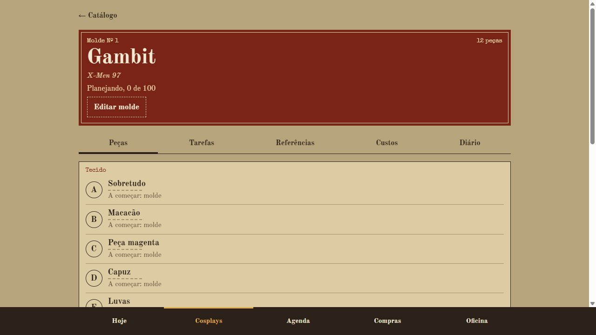

# Alinhavo

Planejador de cosplay para Windows, desenvolvido por [Gabriel Coelho](https://github.com/Biieru).

O Alinhavo organiza cada cosplay como um envelope de molde: peças, etapas, tarefas, referências,
compras e anotações ficam juntas. A interface usa papel kraft, tipografia de impressos e uma
costura como indicador de progresso, trazendo a linguagem de um ateliê para o planejamento.



*Captura da interface compilada com dados demonstrativos. As integrações com o Windows são executadas no aplicativo desktop.*

## Funcionalidades

- Catálogo de cosplays com orçamento e vínculo com eventos.
- Peças com etapas diferentes para tecido, armadura, armas e itens comprados.
- Tarefas com prazo, estimativa de tempo e conclusão.
- Fotos de referência e diário de produção.
- Compras por situação, preços, lojas e previsão de chegada.
- Agenda, medidas e etapas configuráveis.
- Notificações do Windows e execução na bandeja.
- Exportação e importação de backup com dados e fotos.

O aplicativo desktop funciona offline, sem cadastro ou serviço de sincronização.
O primeiro uso inclui um molde de exemplo do Gambit, sem fotos, compras ou medidas pessoais preenchidas.

## Tecnologias e organização

**Electron · TypeScript · Vite · SQLite · HTML · CSS**

A interface usa TypeScript e manipulação do DOM, sem framework de componentes. O processo principal
concentra o banco, os arquivos, os backups e as integrações com o Windows. A ponte de preload expõe
somente as operações usadas pela interface.

```text
src/
  main/        Janela, bandeja, notificações, banco, fotos e backups
  preload/     API entre a interface e o processo principal
  renderer/    Telas, formulários, estilos e fontes locais
  shared/      Tipos, cálculos, datas e validação
tests/         Testes automatizados
scripts/       Geração de ícones e roteiro de testes de interface
resources/     Ícones do aplicativo
build/         Ícones do instalador
Alinhavo.html  Protótipo independente para navegador
```

## Executar localmente

Ambiente de desenvolvimento: Windows 10/11 x64, Node.js 22.12 ou superior e npm.
As versões exatas das dependências estão no `package-lock.json`.

```bash
npm ci
npm run dev
```

O projeto usa o binário N-API pré-compilado do `better-sqlite3` para Windows x64.
Outros sistemas e arquiteturas não foram validados para distribuição.

| Comando | Uso |
|---|---|
| `npm run dev` | Desenvolvimento com recarga da interface |
| `npm run build` | Compila em `out/` |
| `npm run preview` | Executa o app compilado |
| `npm test` | Testes unitários e de integração |
| `npm run typecheck` | Verificação de tipos |
| `npm run lint` | Verificação com ESLint |
| `npm run dist` | Compila e gera instalador e versão portátil |
| `npm run icone` | Recria os ícones a partir do SVG do projeto |

## Dados e backup

Os dados ficam em `%APPDATA%\Alinhavo`: banco `alinhavo.db`, imagens em `fotos/`, cópias anteriores
a importações em `copias-automaticas/` e tamanho e posição da janela em `janela.json`.

O backup `.zip` reúne `dados.json` e as fotos utilizadas. Antes de importar, o app valida o
conteúdo e pede confirmação, pois os dados atuais serão substituídos. Uma cópia automática é
criada antes da troca; são mantidas as dez mais recentes. Também é possível importar o JSON
exportado pelo protótipo em HTML. Fotos externas desse formato antigo não são baixadas.

Os registros são gravados em transação e o esquema é versionado por migrações. As fotos ficam
fora do banco e são servidas pelo protocolo interno `alinhavo-foto://`. Na interface, textos e
identificadores importados são escapados antes de entrar no HTML.

A janela mantém `contextIsolation` e `sandbox` ativos, sem Node.js no renderer. O preload expõe
cinco operações, com validação no processo principal. Links externos abrem no navegador padrão.

Fechar a janela mantém o app na bandeja. Use **Sair** no menu da bandeja para encerrá-lo.
As notificações dependem de o aplicativo estar em execução e das configurações do Windows.
O horário do resumo pode ser alterado em **Oficina → Avisos**. Não há inicialização automática
com o Windows nesta versão.

## Distribuição Windows

```bash
npm run dist
```

Os arquivos são gerados em `release/` e não entram no Git:

- `Alinhavo-Instalador-1.0.0.exe`
- `Alinhavo-Portatil-1.0.0.exe`

O instalador é por usuário. Desinstalar o aplicativo não remove os dados guardados em
`%APPDATA%\Alinhavo`. Os executáveis não possuem assinatura digital e podem receber alertas
de editor desconhecido no Windows. O repositório de código não inclui os instaladores.

## Validação

```bash
npm test
npm run typecheck
npm run lint
npm run build
```

Os testes cobrem cálculos, datas, validação, persistência, migrações, importação e exportação,
recuperação após falhas, fotos, notificações e renderização de identificadores importados.

Há um roteiro adicional em `scripts/teste-e2e/fluxo.mjs`. Ele abre o aplicativo e altera dados;
use uma pasta isolada com `--dados`. O roteiro requer os parâmetros de depuração usados pelo
próprio script e não deve ser executado sobre os dados pessoais do aplicativo.

```powershell
node scripts/teste-e2e/fluxo.mjs --exe node_modules/electron/dist/electron.exe --app . --dados "$env:TEMP/alinhavo-e2e"
```

## Créditos

**Gabriel Coelho** · [GitHub](https://github.com/Biieru) · [Portfólio](https://biieru.github.io/)

- Old Standard TT: SIL Open Font License 1.1.
- Special Elite: Apache License 2.0.
- Os avisos completos das fontes estão em `src/renderer/assets/fonts/LICENSE-*.txt` e acompanham o app.
- Electron, better-sqlite3, fflate e as demais dependências mantêm suas próprias licenças.
- Gambit e X-Men são referências usadas no projeto de exemplo; as marcas e personagens pertencem aos seus titulares.

O código do Alinhavo permanece sem uma licença de uso concedida (`UNLICENSED`).
